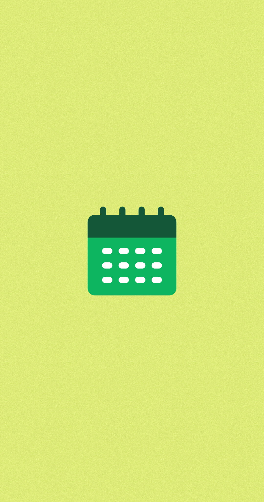
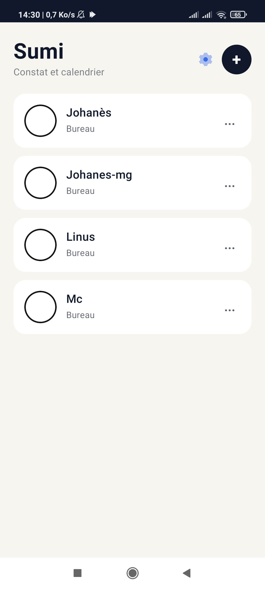
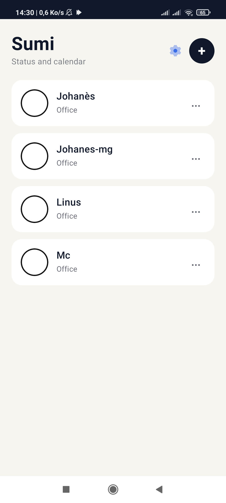
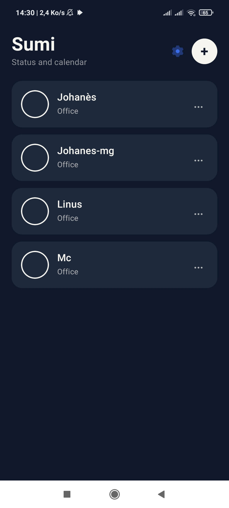
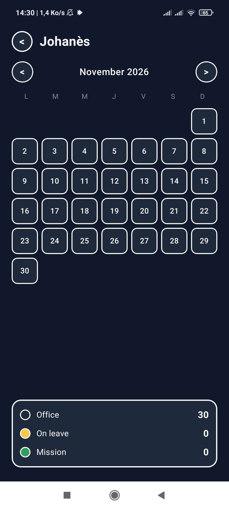
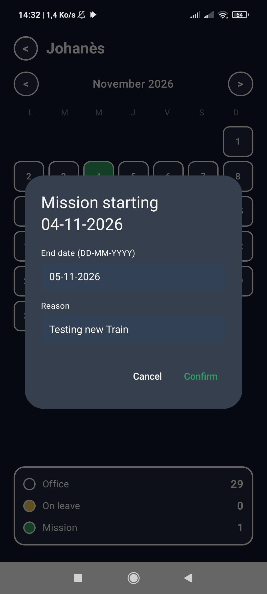
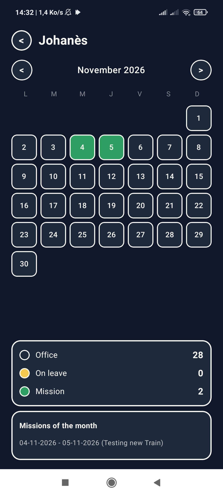
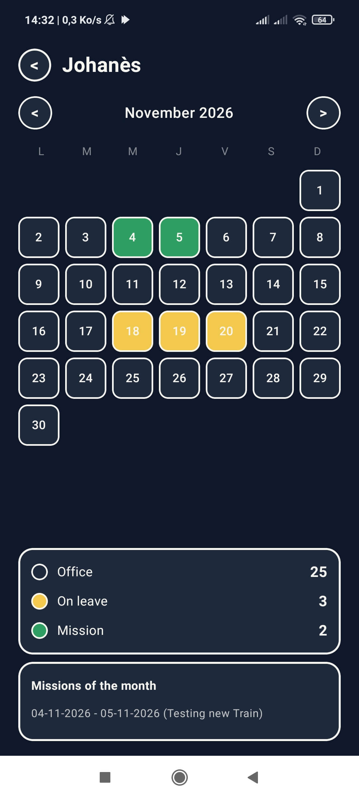
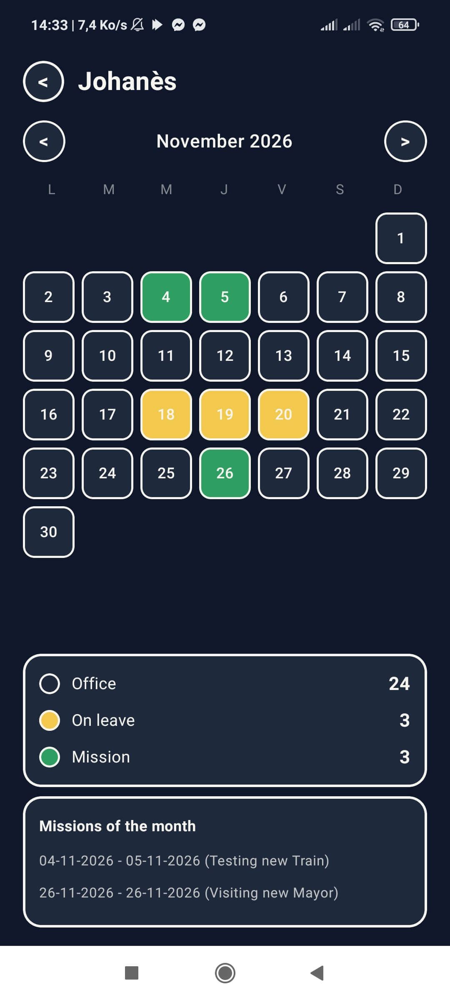

  

  <h1 align="center">Sumi</h1>

  <h3 align="center">Modern Calendar and Constat Management</h3>

  
<strong>An Android application designed to simplify activity tracking, organize personal calendars, and manage daily statuses efficiently.</strong>

  

    
    
    
    
    
  

---

Designed with simplicity and clarity in mind, Sumi helps users keep their personal calendar organized while providing a clear visual overview of daily work statuses.

## Overview

**Sumi** is an Android application developed in Kotlin with Jetpack Compose. It provides a centralized interface for managing people, tracking personal calendars, and visualizing work statuses day by day.

The application combines a modern, responsive interface with local data persistence to deliver a practical daily tracking experience.

## Features

### People Management
- Register and manage people.
- Rename or delete existing people.
- Access each person's personal calendar.
- Keep records organized.

### Personal Calendar
- Monthly calendar view for each person.
- Navigate between months.
- Assign a status to each day.
- View the current month at a glance.

### Day Statuses
- **Libre** (white): free day, no particular status.
- **En congé** (yellow): on leave.
- **Mission** (green): working day.
- Tap a day to cycle through the three statuses.

### Monthly Summary
- Real-time counters at the bottom of the calendar.
- Displays the exact number of work days, leave days, and free days for the displayed month.
- Updates instantly when a day's status changes.

### Visual Design
- Clean, borderless topbar.
- Custom color palette with high contrast.
- Black-bordered indicators for clear distinction of every state.
- Responsive layout suitable for both small and large screens.

---

## Screenshoots

### Logo

### Main Menu

### Dark Main Menu

### Demo

### QR Scan

### Ouverture d'un document

---

---

## Interface

Sumi is designed around a clean and structured mobile interface.

The application focuses on:
- Clear navigation.
- Consistent visual elements.
- Readable information.
- Organized management screens.
- A customizable appearance.

## Technology Stack

| Technology | Purpose |
|---|---|
| **Kotlin** | Core application development |
| **Jetpack Compose** | Declarative UI framework |
| **Material 3** | Modern design system |
| **SharedPreferences** | Local data persistence |
| **R8 / ProGuard** | Code minification and optimization |
| **Baseline Profiles** | Startup performance |

## Project Structure

    Sumi/
    |
    +-- app/
    |   +-- src/main/
    |       +-- java/com/sumijojoh/mg/
    |       |   +-- MainActivity.kt
    |       |   +-- data/
    |       |   |   +-- DayState.kt
    |       |   |   +-- Person.kt
    |       |   |   +-- PersonRepository.kt
    |       |   +-- ui/
    |       |       +-- SumiApp.kt
    |       |       +-- screens/
    |       |       |   +-- PersonCalendarScreen.kt
    |       |       |   +-- PersonListScreen.kt
    |       |       +-- theme/
    |       |           +-- Theme.kt
    |       +-- res/
    |       |   +-- mipmap-*/
    |       |   +-- values/
    |       |       +-- themes.xml
    |       +-- AndroidManifest.xml
    |   +-- build.gradle.kts
    |   +-- proguard-rules.pro
    |
    +-- gradle/
    |   +-- wrapper/
    |
    +-- build.gradle.kts
    +-- settings.gradle.kts
    +-- gradle.properties
    +-- gradlew
    +-- gradlew.bat
    +-- logo.png
    +-- .gitignore
    +-- .gitattributes
    +-- README.md

### Source Code Organization

| File | Responsibility |
|---|---|
| `MainActivity.kt` | Application entry point |
| `DayState.kt` | Day status enum |
| `Person.kt` | Person data model |
| `PersonRepository.kt` | Data persistence and caching |
| `SumiApp.kt` | Main navigation and state management |
| `PersonListScreen.kt` | People list interface |
| `PersonCalendarScreen.kt` | Personal calendar interface |
| `Theme.kt` | Colors, typography and Material theme |

## Getting Started

### Prerequisites

Before working with the source code, make sure you have:

- [OpenJDK 17](https://adoptium.net/) installed
- Android SDK (via `sdkmanager`)
- A Linux or Windows development environment
- A physical Android device or emulator

### Clone the Repository

    git clone https://github.com/Johanes-mg/Sumi.git
    cd Sumi

### Build the Debug APK

    ./gradlew assembleDebug

Output: `app/build/outputs/apk/debug/app-debug.apk`

### Build the Release APK

The release build requires a signing configuration. Create a `signing.properties` file at the project root:

    storeFile=sumi-release.jks
    storePassword=<your_password>
    keyAlias=<your_alias>
    keyPassword=<your_password>

Then run:

    ./gradlew assembleRelease

Output: `app/build/outputs/apk/release/app-release.apk`

### Install on Device

    ./gradlew installDebug

Or transfer the APK manually to the device and install it.

## Design Philosophy

Sumi follows a simple design philosophy:

- **Clarity:** Information should be easy to understand at a glance.
- **Efficiency:** Common operations should remain accessible.
- **Consistency:** Interface elements should behave consistently.
- **Memory efficiency:** Minimal allocations to reduce garbage collection.
- **Maintainability:** The codebase is separated into dedicated modules.

## Data and Persistence

Sumi uses Android SharedPreferences for local data persistence. Person information and their personal calendars are stored in a compact serialized format.

Data is written after each significant change. The application caches loaded data in memory to reduce disk reads.

Users should maintain regular backups if data is important to them.

## Performance

Sumi is optimized for low-end and mid-range Android devices:

- **R8 full mode** for aggressive code shrinking and optimization.
- **Resource shrinking** to remove unused resources.
- **Baseline Profiles** for faster startup.
- **Compiled month keys** (`year * 12 + month`) to avoid `Calendar` allocations.
- **SnapshotStateList** for efficient list updates without copying.
- **Precomputed counters** for the monthly summary.

The release APK is typically under 1 MB, providing fast startup and smooth scrolling on modest hardware.

## Contributing

Contributions, suggestions, and bug reports are welcome.

If you would like to contribute:

1. Fork the repository.
2. Create a feature branch.
3. Implement your changes.
4. Test your modifications.
5. Submit a pull request.

Please keep the code organized and follow the existing project structure.

## Auteur

* **Johanes-mg**

## License

A license has not yet been specified for this project.

Please contact the project owner for information about usage, modification, and distribution permissions.

---

**Sumi - Making Management Simpler.**

*Built with Kotlin. Designed for Efficiency.*

